

  <a href="assets/hero-wide-dark.svg#gh-dark-mode-only"><picture><source media="(min-width: 1240px)" srcset="assets/hero-wide-dark.svg"><source media="(min-width: 880px)" srcset="assets/hero-medium-dark.svg"></picture></a>
  <a href="assets/hero-wide-light.svg#gh-light-mode-only"><picture><source media="(min-width: 1240px)" srcset="assets/hero-wide-light.svg"><source media="(min-width: 880px)" srcset="assets/hero-medium-light.svg"></picture></a>

  <a href="https://jobbliggaren.se"><picture><source media="(prefers-color-scheme: dark)" srcset="assets/pill-jobbliggaren-dark.svg"></picture></a>
  <a href="https://yobber.se"><picture><source media="(prefers-color-scheme: dark)" srcset="assets/pill-yobber-dark.svg"></picture></a>
  <a href="https://kalaskoll.se"><picture><source media="(prefers-color-scheme: dark)" srcset="assets/pill-kalaskoll-dark.svg"></picture></a>

**Based in Göteborg. Open to developer roles and consulting work, on site in the Göteborg area or remote anywhere in Sweden.** [klasolsson.se](https://klasolsson.se) · [LinkedIn](https://www.linkedin.com/in/klasolsson81) · [klasolsson81@gmail.com](mailto:klasolsson81@gmail.com)

I build products end to end: the data model, the API, the interface and the server they run on. Before software I spent more than 20 years in automotive manufacturing as an operator, team lead and project lead. It taught me to care about process and about things that keep running. I study .NET systems development at NBI/Handelsakademin in Göteborg (2025–2027). My internship is at Yobber, where I work as a full-stack developer and technical lead.

## `01` Featured work

### Jobbliggaren

  <picture>
    <source media="(min-width: 1240px)" srcset="assets/showcase/jobbliggaren.webp"><source media="(min-width: 880px)" srcset="assets/showcase/jobbliggaren-medium.webp">
    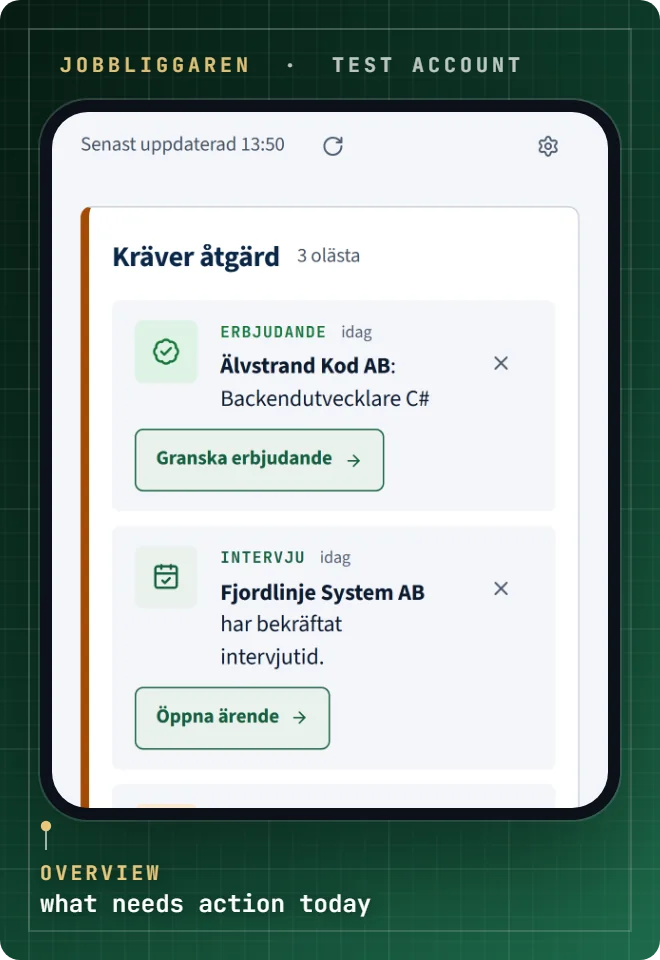
  </picture>

**A Swedish job search and application tracker, built to work like a public service.**
[jobbliggaren.se](https://jobbliggaren.se) · [Code](https://github.com/klasolsson81/jobbliggaren) · [Decision records](https://github.com/klasolsson81/jobbliggaren/tree/main/docs/decisions) · [Threat model](https://github.com/klasolsson81/jobbliggaren/blob/main/docs/threat-model.md)

My own product. I build and run it alone, working with AI coding agents; the process is described below the numbers. It is for job seekers in Sweden, who are expected to keep track of what they apply for and report it every month. You search the ads on Platsbanken (Sweden's public job board), track each application from draft to offer and follow companies. The CV review quotes the text it is judging. It is in early testing with real users, and registration is open.

  <picture>
    <source media="(min-width: 1240px)" srcset="assets/showcase/jobbliggaren-detail.webp"><source media="(min-width: 880px)" srcset="assets/showcase/jobbliggaren-detail-medium.webp">
    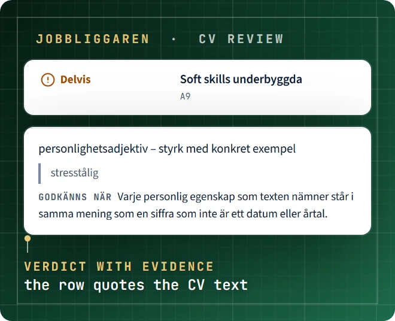
  </picture>

- **Product.** Plain Swedish, named grades instead of scores, and every verdict with its evidence. Each match gets a grade from Grundmatch to Toppmatch, with the matched and missing skills listed. Matching and CV review are [rule engines](https://github.com/klasolsson81/jobbliggaren/blob/main/docs/decisions/0076-match-sort-deterministic-matching-engine-activation.md). The product makes no LLM calls, so the same input always gives the same verdict.
- **Architecture.** Built on .NET 10 with Clean Architecture, DDD and CQRS. The [layer rules are tests](https://github.com/klasolsson81/jobbliggaren/tree/main/tests/Jobbliggaren.Architecture.Tests) that fail the build. Next.js 16 and React 19 in front, PostgreSQL 18 and Redis behind. Hangfire runs [25 background jobs](https://github.com/klasolsson81/jobbliggaren/blob/main/src/Jobbliggaren.Application/BackgroundJobs/RecurringJobIds.cs) on a schedule.
- **Operations.** It started on AWS and moved off to fit a student budget ([ADR 0050](https://github.com/klasolsson81/jobbliggaren/blob/main/docs/decisions/0050-deployment-migration-aws-exit-hetzner.md), in Swedish). It now runs on one rented [server in Germany](https://github.com/klasolsson81/jobbliggaren#security-and-privacy) that I set up, hardened and maintain. [Nine Compose services](https://github.com/klasolsson81/jobbliggaren/blob/main/deploy/docker-compose.yml) (eight long-running and a one-shot migration) run behind a default-drop firewall, and only Caddy is exposed.
- **Data.** Encrypted backups go off site every night. The [restore commands run in CI](https://github.com/klasolsson81/jobbliggaren/blob/main/docs/runbooks/backup-restore.md) against real PostgreSQL; a full restore from a production backup has not been drilled yet. [CVs, cover letters and notes are encrypted per user](https://github.com/klasolsson81/jobbliggaren#security-and-privacy), and deleting an account destroys its key.
- **Delivery.** Every release is built, scanned, signed and sealed into one record. The server pulls that record and verifies it before anything starts. CI holds no credential for the server.

  <a href="assets/pipeline-wide-dark.svg#gh-dark-mode-only"><picture><source media="(min-width: 1240px)" srcset="assets/pipeline-wide-dark.svg"><source media="(min-width: 880px)" srcset="assets/pipeline-medium-dark.svg"></picture></a>
  <a href="assets/pipeline-wide-light.svg#gh-light-mode-only"><picture><source media="(min-width: 1240px)" srcset="assets/pipeline-wide-light.svg"><source media="(min-width: 880px)" srcset="assets/pipeline-medium-light.svg"></picture></a>

Fig. 1 in words, with the files that implement it

1. A pull request passes the required CI checks and the review agents, and is squashed onto a linear `main`.
2. [`release-images.yml`](https://github.com/klasolsson81/jobbliggaren/blob/main/.github/workflows/release-images.yml) is scheduled hourly, but GitHub starts only a few of those runs a day. It builds five images (api, worker, migrate, web, caddy) from one pinned commit, scans each with Trivy, pushes them and attests their build provenance.
3. Only when all five succeed does it write one immutable release record. The record names the five digests, the deployment files and the migrations, and is attested too ([ADR 0149](https://github.com/klasolsson81/jobbliggaren/blob/main/docs/decisions/0149-a-release-is-one-verified-record-the-channel-moves-only-after-the-whole-set-and-the-box-applies-exactly-what-it-names.md)).
4. On the server a systemd timer runs hourly. [`jobbliggaren-reconcile.sh`](https://github.com/klasolsson81/jobbliggaren/blob/main/deploy/systemd/jobbliggaren-reconcile.sh) verifies the record's signature, checks that each image was built from the record's commit, runs the schema gate, starts the containers, waits for them to be healthy and writes a receipt.
5. A failed run writes no receipt and puts the local image tags back as it found them. Running containers are not rolled back automatically. To roll back, pin an earlier record and run the same systemd unit. That rolls back code, not schema: the schema gate refuses an older release that does not know a migration already applied.
6. A release that changes the Compose file waits until the server's checkout is advanced outside the timer. An agent session does that under a standing go-ahead I gave; release pins and anything else on the server need my explicit go-ahead ([ADR 0154](https://github.com/klasolsson81/jobbliggaren/blob/main/docs/decisions/0154-one-box-one-domain-every-merged-release-goes-live-on-jobbliggaren-se.md)).

  <a href="https://raw.githubusercontent.com/klasolsson81/klasolsson81/generated/jobbliggaren-stats-wide-dark.svg#gh-dark-mode-only"><picture><source media="(min-width: 1240px)" srcset="https://raw.githubusercontent.com/klasolsson81/klasolsson81/generated/jobbliggaren-stats-wide-dark.svg"><source media="(min-width: 880px)" srcset="https://raw.githubusercontent.com/klasolsson81/klasolsson81/generated/jobbliggaren-stats-medium-dark.svg">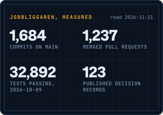</picture></a>
  <a href="https://raw.githubusercontent.com/klasolsson81/klasolsson81/generated/jobbliggaren-stats-wide-light.svg#gh-light-mode-only"><picture><source media="(min-width: 1240px)" srcset="https://raw.githubusercontent.com/klasolsson81/klasolsson81/generated/jobbliggaren-stats-wide-light.svg"><source media="(min-width: 880px)" srcset="https://raw.githubusercontent.com/klasolsson81/klasolsson81/generated/jobbliggaren-stats-medium-light.svg">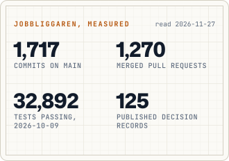</picture></a>

As of November 2026 the repository has about 1,700 commits on main, about 1,200 merged pull requests and 120 published decision records, and 32,892 tests passed in the CI run of 9 October 2026. Those numbers come from one developer working with AI coding agents under written rules. I set the scope and the direction of the architecture and own the rules. Within those rules the agents make and record some decisions themselves (a handful of the decision records are theirs alone), and they can amend the rules through the same gate as any other change.

A change merges when CI and the architecture tests pass and the reviewer agents assigned to it approve. I read the diff after it lands, and I run the server. Dependency updates merge when CI and a vulnerability gate pass. Pull requests have been required since late May 2026 ([ADR 0065](https://github.com/klasolsson81/jobbliggaren/blob/main/docs/decisions/0065-pr-flow-restoration-with-ci-gate.md)) and auto-merge on the agents' sign-off since June; the first 450 or so commits went straight to main. The repository's [README](https://github.com/klasolsson81/jobbliggaren#how-it-is-built) describes the process.

`.NET 10` `C# 14` <code>EF&nbsp;Core</code> <code>PostgreSQL&nbsp;18</code> `Redis` `Hangfire` <code>Next.js&nbsp;16</code> <code>React&nbsp;19</code> `TypeScript` `Tailwind` <code>Docker&nbsp;Compose</code> `Caddy` <code>GitHub&nbsp;Actions</code>

### Yobber

  <picture>
    <source media="(min-width: 1240px)" srcset="assets/showcase/yobber.webp"><source media="(min-width: 880px)" srcset="assets/showcase/yobber-medium.webp">
    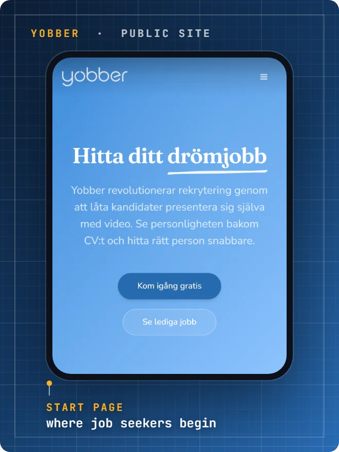
  </picture>

**A Swedish recruitment platform: a job board and applicant tracking in one, with a branded careers page for each employer.**
[yobber.se](https://yobber.se) · the platform runs at [nya.yobber.se](https://nya.yobber.se)

Not my product. I work on it as a full-stack developer and technical lead, on an internship (LIA, a work placement within my degree) that started in August 2026. The code is private and the employer side is not mine to show, so the image shows the public candidate view.

- Retired the legacy platform's infrastructure after the new platform took over.
- Responsible for architecture, security and GDPR in the personality-test module.
- Wrote most of the database test suite (pgTAP) from September, and moved type checks, unit tests, database tests and edge-function checks into a CI pipeline in November.
- Wrote the local development setup and onboarded new developers.
- From 31 August to 15 November 2026 I merged 173 pull requests to main and promoted main to production 212 times; each promotion deploys. The counts are high because the work is agent-assisted and lands in small steps.

<code>React&nbsp;18</code> `TypeScript` `Vite` `Supabase` <code>PostgreSQL&nbsp;RLS</code> <code>Edge&nbsp;Functions&nbsp;(Deno)</code> `pgTAP` `Vitest` `Vercel`

### KalasKoll

  <picture>
    <source media="(min-width: 1240px)" srcset="assets/showcase/kalaskoll.webp"><source media="(min-width: 880px)" srcset="assets/showcase/kalaskoll-medium.webp">
    
  </picture>

**Invitations for children's birthday parties, with RSVP by QR code.**
[kalaskoll.se](https://kalaskoll.se) · the code is private

Built for my own child's party, then opened as a small service for other parents. Solo build.

- Invitation cards come from templates or from an image model. If one image provider fails, the next takes over.
- Guests answer on their phone. Allergy information is encrypted with AES-256-GCM and deleted on a schedule after the party.
- Stripe payments for the paid tier, and rate limiting. Unit and end-to-end tests run in CI.

<code>Next.js&nbsp;16</code> <code>React&nbsp;19</code> `TypeScript` `Supabase` `Stripe` <code>Tailwind&nbsp;4</code> `Vitest` `Playwright` `Vercel`

## `02` Also built

  <a href="assets/showcase/also-dark.webp#gh-dark-mode-only"><picture><source media="(min-width: 1240px)" srcset="assets/showcase/also-dark.webp"><source media="(min-width: 880px)" srcset="assets/showcase/also-medium-dark.webp">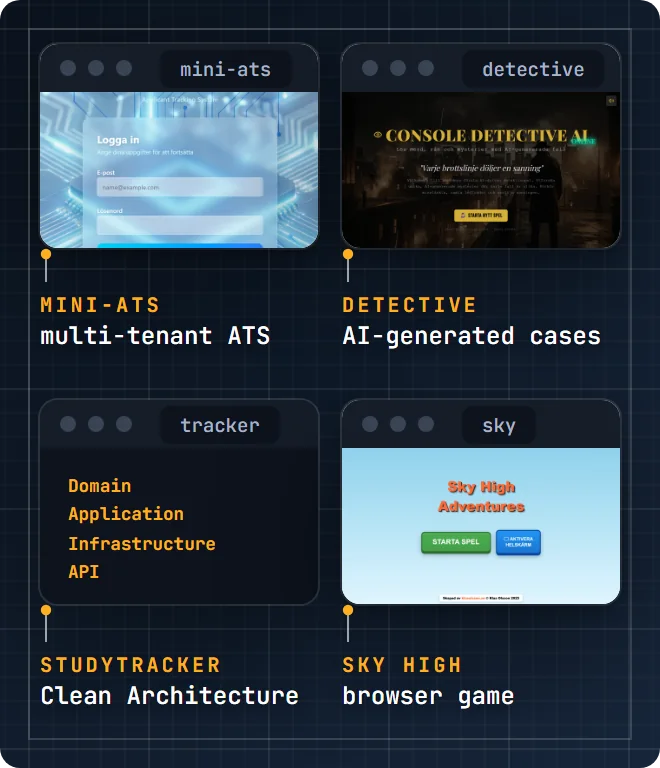</picture></a>
  <a href="assets/showcase/also-light.webp#gh-light-mode-only"><picture><source media="(min-width: 1240px)" srcset="assets/showcase/also-light.webp"><source media="(min-width: 880px)" srcset="assets/showcase/also-medium-light.webp">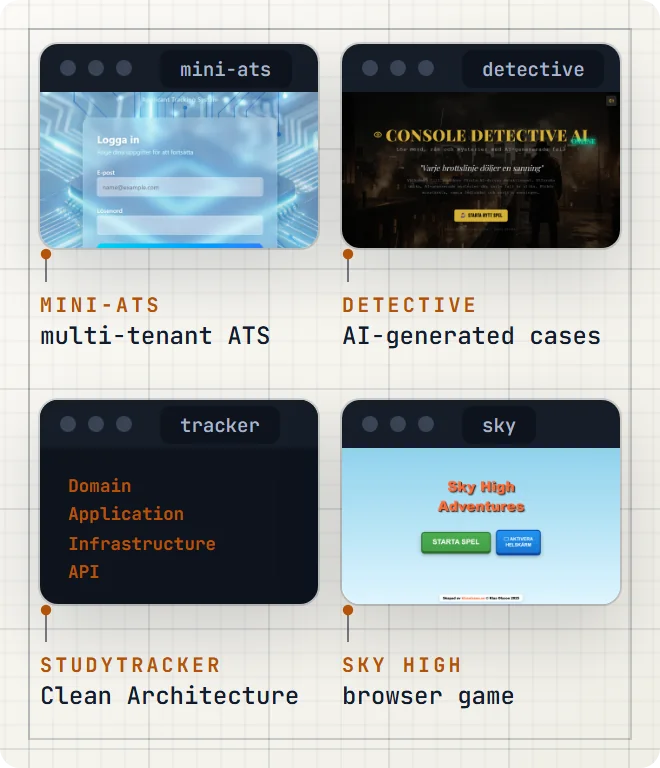</picture></a>

- **[mini-ats](https://github.com/klasolsson81/mini-ats)** · Multi-tenant applicant tracking with row-level security, a kanban board and an audit log. Next.js and Supabase. Runs at [mini-ats-jade.vercel.app](https://mini-ats-jade.vercel.app).
- **[Console Detective](https://github.com/klasolsson81/console-detective-web)** · A noir detective game with AI-generated cases. React client on a .NET 8 API. Runs at [console-detective-web.vercel.app](https://console-detective-web.vercel.app).
- **[StudyTracker](https://github.com/klasolsson81/StudyTracker)** · A Web API where students log study sessions and how motivated they felt before and after. Clean Architecture in .NET 10 with CQRS, MediatR, EF Core and JWT.
- **[Sky High Adventures](https://github.com/klasolsson81/sky-adventure-game)** · An endless-runner browser game in React and Phaser 3. Runs at [skyadventuregame.klasolsson.se](https://skyadventuregame.klasolsson.se).

## `03` Toolbox

| Area | What I use |
|:---|:---|
| **Backend** | `C#` <code>.NET&nbsp;10</code> <code>ASP.NET&nbsp;Core</code> <code>EF&nbsp;Core</code> `CQRS` `FluentValidation` `Hangfire` |
| **Frontend** | `TypeScript` `React` `Next.js` `Tailwind` `shadcn/ui` <code>React&nbsp;Hook&nbsp;Form</code> `Zod` |
| **Data** | `PostgreSQL` <code>SQL&nbsp;Server</code> `Redis` `Supabase` <code>row&#8209;level&nbsp;security</code> |
| **Operations** | `Linux` `Docker` `Caddy` <code>GitHub&nbsp;Actions</code> `Vercel` |
| **Quality** | <code>Clean&nbsp;Architecture</code> `DDD` `xUnit` `Testcontainers` `Vitest` `Playwright` <code>decision&nbsp;records</code> |
| **AI** | <code>Claude&nbsp;API</code> <code>OpenAI&nbsp;API</code> <code>tool&nbsp;calling</code> <code>Claude&nbsp;Code</code> `Codex` |

## `04` Activity

  <a href="https://raw.githubusercontent.com/klasolsson81/klasolsson81/generated/activity-wide-dark.svg#gh-dark-mode-only"><picture><source media="(min-width: 1240px)" srcset="https://raw.githubusercontent.com/klasolsson81/klasolsson81/generated/activity-wide-dark.svg"><source media="(min-width: 880px)" srcset="https://raw.githubusercontent.com/klasolsson81/klasolsson81/generated/activity-medium-dark.svg"></picture></a>
  <a href="https://raw.githubusercontent.com/klasolsson81/klasolsson81/generated/activity-wide-light.svg#gh-light-mode-only"><picture><source media="(min-width: 1240px)" srcset="https://raw.githubusercontent.com/klasolsson81/klasolsson81/generated/activity-wide-light.svg"><source media="(min-width: 880px)" srcset="https://raw.githubusercontent.com/klasolsson81/klasolsson81/generated/activity-medium-light.svg"></picture></a>

More than 8,000 contributions in the last twelve months, on about four days out of five. The longest unbroken run was about ten weeks. Most of them come from the agent-assisted work on Jobbliggaren and Yobber described above.

## `05` Contact

Developer roles and consulting, on site in the Göteborg area or remote anywhere in Sweden: [klasolsson.se](https://klasolsson.se) · [LinkedIn](https://www.linkedin.com/in/klasolsson81) · [klasolsson81@gmail.com](mailto:klasolsson81@gmail.com)

Every graphic on this page is built from this repository. Text is outlined at build time, so no font loads in your browser. Each SVG drawing has a dark and a light variant, and two are redrawn daily from the GitHub API. The code is in <a href="scripts">scripts/</a>, and the figures on this page, with the query and date for each, are in <a href="content/facts.json">content/facts.json</a>.
